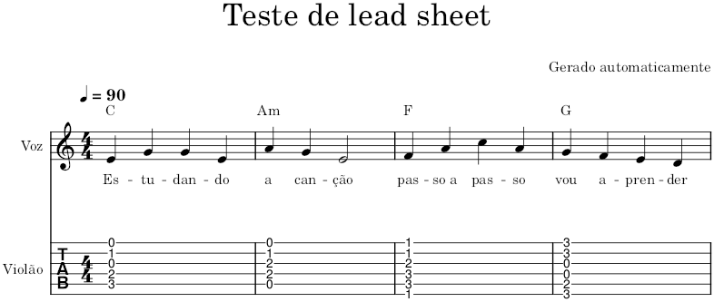

# will-music: contexto, pesquisa e decisões

Registro da conversa de concepção de 06/11/2026. Junta tudo o que foi analisado, testado e decidido até aqui, para servir de base ao design e ao plano de implementação.

> Status: **em concepção**. O escopo da V1 ainda está sendo fechado; nada aqui é especificação final.

Documento complementar (com diagramas de arquitetura e roadmap): [App open source de cifras e partituras — levantamento técnico](https://claude.ai/artifact/EWkBnMESZ2v3qJUfrvmMpB).

---

## 1. Por que o projeto existe

- O autor é músico. As ferramentas boas para estudar e "tirar" músicas são pagas e espalhadas: Cifra Club (cifras), Moises (separação de faixas, acordes), MuseScore (partituras).
- Um app anterior foi iniciado e não terminado: `D:\Code\cifras.app` (web em Next.js + mobile em Expo). Ele é a referência de estilo e de funcionalidades.
- A ideia agora: um app de música completo, gratuito e aberto, que ajude a aprender, tirar e tocar músicas.

## 2. Visão

### Destino (longo prazo): app de grupo, online

Um grupo (banda, ministério de louvor, coral) compartilha o repertório. Uma pessoa monta as músicas do ensaio ou show; todos veem **a mesma música, na mesma versão e no mesmo tom**, cada um com **a sua parte**: cifra e diagramas para o violão, linha de baixo, letra e melodia do naipe para quem canta, partitura para o teclado. Backend previsto: Supabase ou Firebase.

### Ponto de partida: versão individual, PWA, local-first

Um app para uma pessoa, completo, que instala no celular e no computador, funciona offline e guarda tudo no aparelho. O modelo de dados já nasce preparado para sincronizar com o online depois.

### Funcionalidades desejadas (todas as fases)

- Salvar e ler cifras (editor, transposição, rolagem automática).
- Analisar uma música enviada: identificar, buscar letra, detectar acordes e tom, gerar a cifra.
- Separar instrumentos e voz.
- Montar partituras e tablaturas.
- Identificar linhas melódicas das vozes: soprano, contralto, tenor, barítono/baixo.
- Player com controle de velocidade e rolagem da letra.
- Corrigir o resultado da IA: editar a cifra e a partitura.
- Design moderno voltado ao aprendizado.

## 3. Decisões tomadas até agora

| Decisão | Escolha | Quem decidiu |
|---|---|---|
| Plataforma | PWA (desktop, celular, instalável). Sem app desktop na V1. | Usuário pediu PWA; Claude recomendou não fazer desktop, pois só acrescentaria o download do YouTube |
| Onde processa | 100% no navegador (onnxruntime-web + WebGPU); sem servidor de processamento | Conversa |
| Dados na V1 | Locais: IndexedDB para registros, armazenamento de arquivos do navegador (OPFS) para áudios e faixas | Sugestão do Claude |
| Preparar para o online | Todo registro com ID único (UUID) e data de alteração, para sincronizar depois com Supabase/Firebase | Sugestão do Claude |
| Formato da cifra | ChordPro (o formato `[C]` do cifras.app já é praticamente isso) | Sugestão do Claude |
| Formato de partitura/tablatura | MusicXML (abre no MuseScore, renderiza com OSMD/VexFlow) | Sugestão do Claude |
| Formato da análise | JSON (acordes com tempo, tom, batidas, notas) | Sugestão do Claude |
| Backup e compartilhamento offline | Pacote por música (`.zip`) com ChordPro, MusicXML, JSON e faixas | Sugestão do Claude |
| Online (fase futura) | Supabase ou Firebase | Usuário |

### V1 (em discussão)

Base aceita pelo usuário: **adicionar um MP3, identificar acordes e letra, com possibilidade de separar as faixas.**

Fluxo proposto:

1. Adicionar o MP3; ler título e artista das tags ID3 (ou o usuário digita/corrige).
2. Análise no navegador: tom (S-KEY), acordes no tempo (ChordMini), batidas e compassos (Beat This).
3. Letra: LRCLIB com tempo por linha; se não achar, o usuário cola a letra.
4. Cifra gerada juntando letra e acordes pelo tempo, em ChordPro.
5. Separação de faixas: voz/instrumental por padrão; 6 faixas opcional; mixer com mudo, solo e volume.
6. Biblioteca local com exportação do pacote da música.

Confirmado pelo usuário em seguida:

- **Player** incluído, com controle de **velocidade de rolagem da letra**.
- Quando a IA errar, o usuário deve poder **editar a cifra ou a partitura**.

Em aberto: se partitura, tablatura e vozes por naipe entram na V1 ou em versões seguintes (ver seção 9).

## 4. Referências analisadas

| App | O que é | Onde processa | Separação | Acordes | O que aproveitar |
|---|---|---|---|---|---|
| Moises Desktop 2.0.7 | Electron que abre `studio.moises.ai` em abas | Servidor | Sim | Sim | Referência de produto; não há IA no PC |
| Tonespell / Mosaic | App Tauri (Rust) para pedaleiras de guitarra, com modo estudo | Local, ONNX Runtime | Demucs 6 faixas (`htdemucs_6s` fp16, 136 MB, baixado do Hugging Face, conferido por SHA-256) | Não encontrado | Prova de modelo local em produto comercial; recursos de estudo: velocidade, tom, loop A-B, speed trainer, gap trainer, metrônomo |
| [Musetric](https://github.com/musetric/musetric) | App web de treino vocal, TypeScript, código MIT | Navegador (WebGPU) | Voz/instrumental | Sim | Implementações prontas: CQT na GPU, separação em blocos, Whisper. Nome e logo são marca reservada |
| [YouTube-Music-Download](https://github.com/Refloow/YouTube-Music-Download) | Electron em volta de yt-dlp + ffmpeg, MIT | Local | Não | Não | Confirma: download do YouTube só em app desktop |
| cifras.app (do autor) | Next.js 14 + shadcn/Radix + Tailwind; Firebase; Expo no mobile | Servidor (Firebase) | Não | Detecção de tom por texto | Referência de estilo e funcionalidades (seção 5) |

Como foi analisado: Moises pela extração do `app.asar`; Tonespell pelas strings dos binários `mosaic-app.exe` e `engine/livtra.dll`. O Musetric não foi executado; os dados vêm do repositório e das fichas dos modelos.

## 5. O que existe no cifras.app (referência)

- **Stack:** Next.js 14, React 18, Tailwind, shadcn/ui (Radix), lucide-react, zustand, react-hook-form + zod, Firebase (auth, Firestore, push), VexFlow (partituras); mobile em Expo com abcjs.
- **Visual:** tema claro e escuro; cor principal verde esmeralda (`hsl(160 84% 39%)`, `45%` no escuro); raio 0,5 rem; scrollbar em verde.
- **Cifras:** editor e visualizador com acordes inline `[C]`, transposição, zoom de texto, rolagem automática com velocidade, wake lock (tela não apaga), detecção de tom pelo texto.
- **Metadados de cifra:** título, artista, tom, andamento, compasso, capotraste, dificuldade, tags, gênero, ano, duração.
- **Setlists:** colaborativas, arrastar e soltar, permissões (ver, editar, admin), compartilhamento, templates.
- **Social:** perfil, seguir, descobrir usuários, ranking e avaliação de cifras, notificações.
- **Partituras:** criar e visualizar (VexFlow).
- **PWA:** manifest, service worker, prompt de instalação.

## 6. Modelos encontrados no Hugging Face

| Necessidade | Modelo | Tamanho | Licença | Onde roda | Observação |
|---|---|---|---|---|---|
| Acordes | [musetric/chordmini-onnx](https://huggingface.co/musetric/chordmini-onnx) | 17 MB | MIT | Navegador (WebGPU) | 170 acordes (maior, menor, 7, maj7, dim, sus…). Só a rede: o app calcula o CQT (librosa 0.11, 22050 Hz, hop 2048, 144 bins), janelas de 108 quadros em grupos de 16, suavização + argmax. Mixagem mono deve ser média `(L+R)/2` |
| Acordes (alternativa) | [puar-playground/btc-chord](https://huggingface.co/puar-playground/btc-chord) | 12 MB | MIT | Local (PyTorch) | BTC |
| Acordes (alternativa) | [anime-song/Tsumugi-Chords](https://huggingface.co/anime-song/Tsumugi-Chords) | 68 MB | CC-BY-NC | Local | Só uso não comercial |
| Tom | [musetric/skey-onnx](https://huggingface.co/musetric/skey-onnx) | 0,3 MB | MIT | Navegador, CPU (wasm) | S-KEY (Deezer). Entrada: 22050 Hz mono normalizado pelo pico. Um tom por música; usar a faixa instrumental. A "confiança" não é calibrada |
| Batida e compasso | [musetric/beat-this-onnx](https://huggingface.co/musetric/beat-this-onnx) | 190 MB | MIT | Navegador | |
| Voz / instrumental | [musetric/mel-band-roformer-duality-student-onnx](https://huggingface.co/musetric/mel-band-roformer-duality-student-onnx) | 213 MB | Apache-2.0 | Navegador (WebGPU) | Janela fixa de ~11 s; STFT/iSTFT no app |
| Voz principal / backing vocal | `musetric/mel-band-roformer-duality-kara2-student-onnx`, `musetric/uvr-mdxnet-kara2-onnx` | não medido | não conferida | Navegador | Modelos "karaoke": separam voz principal dos backings |
| 6 faixas | [StemSplitio/htdemucs-6s-onnx](https://huggingface.co/StemSplitio/htdemucs-6s-onnx) | 136 MB (fp16) | MIT | Navegador ou local | Bateria, baixo, voz, guitarra, piano, outros. Mesmo modelo do Tonespell |
| Letra (plano B) | [onnx-community/whisper-*_timestamped](https://huggingface.co/onnx-community/whisper-large-v3-turbo_timestamped) | 40 MB (tiny) a ~775 MB (turbo) | MIT | Navegador (transformers.js) | Tempo por palavra; só quando o LRCLIB não tiver a letra |
| Notas (um instrumento) | [AEmotionStudio/basic-pitch-onnx-models](https://huggingface.co/AEmotionStudio/basic-pitch-onnx-models) | 0,2 MB | Apache-2.0 | Navegador | Spotify Basic Pitch; polifônico; bom para a melodia da voz separada |
| Notas (banda inteira) | [ONLY4DarkKnight/YourMT3-plus-onnx](https://huggingface.co/ONLY4DarkKnight/YourMT3-plus-onnx) | ~190 MB | Apache-2.0* | Local (CPU) | Export não oficial. *Dados de treino incluem uso não comercial (MAESTRO) |
| Notas (piano) | [TuesdayCrowd/transkun-onnx](https://huggingface.co/TuesdayCrowd/transkun-onnx) | ~57 MB | MIT | Local | Precisão de ponta; decodificação semi-CRF fica no app |

Não usar: `musetric/vocal-separation-roformer-onnx` (licença não confirmada pela própria ficha).

Não existe: modelo pronto de áudio para tablatura. Caminho: transcrever notas e calcular corda/casa por algoritmo.

## 7. Fontes de dados sem IA (testadas em 06/11/2026)

| Fonte | O que entrega | Resultado do teste |
|---|---|---|
| oEmbed do YouTube (`https://www.youtube.com/oembed?url=<link>&format=json`) | Título, canal, miniatura | Funciona; CORS liberado (chamável do navegador) |
| [LRCLIB](https://lrclib.net) (`/api/search?track_name=&artist_name=`) | Letra com tempo por linha (`[00:19.32] ...`) | Funciona; CORS liberado; 6 de 6 músicas brasileiras com letra sincronizada: Evidências, Garota de Ipanema, Trem-Bala, Leão, Ainda Bem, Tempo Perdido |
| Chromaprint + AcoustID | Identificação pelo áudio | Não testado |

Origem do áudio: upload de arquivo (V1), captura do áudio de uma aba (futuro; permite acordes ao vivo), yt-dlp (só em app desktop; viola os termos do YouTube se feito em servidor).

## 8. Partituras: fluxo e teste com o MuseScore

Fluxo: transcrição de notas (IA) → quantização em compassos usando a batida (código; é o gargalo real) → montagem do MusicXML com melodia, acordes e letra (código) → desenho (OpenSheetMusicDisplay ou VexFlow no navegador; MuseScore para editar e imprimir).

Bibliotecas de desenho: OpenSheetMusicDisplay (MusicXML), VexFlow (partitura e tablatura; o cifras.app já usa), abcjs, svguitar (diagramas de acorde), chords-db (posições de acordes).

**Teste com o MuseScore 4.6.4 local** (`C:\Program Files\MuseScore 4\bin\MuseScore4.exe`): um MusicXML gerado por código (melodia original de 4 compassos, cifras C–Am–F–G, letra silabada, tablatura de 6 cordas) foi renderizado com `MuseScore4.exe -o saida.png entrada.musicxml` em ~2 s, sem ajuste manual. Cifras, melodia, letra com hífens e casas da tablatura saíram corretas; PNG, PDF e MIDI exportados. Diagramas de acorde não foram testados. Arquivos em [`docs/testes/musescore/`](testes/musescore/).

Licença do MuseScore: GPL-3. Abrir o arquivo nele ou chamar o executável instalado pelo usuário não afeta a licença do projeto; embutir o código dele, sim.

## 9. Viabilidade por recurso

| Recurso | Viabilidade | Observação |
|---|---|---|
| Tom | Alta | Modelo de 0,3 MB |
| Letra sincronizada | Alta | LRCLIB; Whisper como plano B |
| Acordes | Média-alta | Bom em pop/sertanejo/rock; erra mais em MPB/bossa/jazz. **Validar antes de tudo** |
| Alinhar acorde com sílaba | Média | LRCLIB dá tempo por linha; tempo por palavra exige Whisper ou aproximação |
| Separação voz/instrumental | Média-alta | 213 MB; precisa de WebGPU |
| Separação em 6 faixas | Média | 136 MB; pesado em PC fraco e celular |
| Diagramas de acorde | Alta | Biblioteca pronta, sem IA |
| Lead sheet (melodia + acordes + letra) | Média | Basic Pitch na voz separada + quantização |
| Tablatura da melodia | Média | Notas + algoritmo de corda/casa |
| Partitura de piano | Média-alta | Transkun, se a música for de piano |
| Partitura da banda inteira | Baixa | Muitas notas erradas; nem ferramentas pagas fazem bem |
| Vozes por naipe (SATB) | Baixa em mixagem de banda; média em coral limpo | Isolar o vocal, detectar notas simultâneas e distribuir por extensão vocal. Recurso experimental |
| Editar a cifra | Alta | Editor de texto ChordPro |
| Editar a partitura | Baixa se for um editor completo; média se for edição leve | Editor de partitura completo é um projeto do tamanho do MuseScore. Alternativa: edição leve no app + "abrir no MuseScore" |
| Online com grupos | Alta tecnicamente | Exige servidor (Supabase/Firebase); fase posterior |

## 10. Riscos e licenças

- **Precisão dos acordes** é o maior risco técnico; medir com 3 a 5 músicas reais contra cifras conhecidas antes de construir a interface.
- **Versão da música** (ao vivo, acústica) pode não bater com o tempo da letra do LRCLIB; comparar durações.
- **Hardware:** WebGPU funciona bem no Chrome e no Edge; Safari e Firefox são mais recentes nisso. Precisa de modo leve (acordes e tom, ~17 MB) e modelos pesados opcionais, baixados sob demanda e guardados em cache (~1 GB no modo completo).
- **YouTube:** nenhum servidor do projeto baixa áudio.
- **Licenças:** nome e logo "Musetric" são reservados; Tsumugi-Chords e YourMT3+ só para uso não comercial; ffmpeg (LGPL/GPL) e MuseScore (GPL-3) têm regras próprias se distribuídos.

## 11. Perguntas em aberto

- Partitura, tablatura e vozes por naipe entram na V1 ou nas versões seguintes?
- Que nível de edição de partitura é esperado (ajustes de notas no app ou edição completa)?
- Quais instrumentos são prioridade para "cada um ver a sua parte"?
- Nome definitivo e identidade visual (o verde esmeralda do cifras.app continua?).
- Lista de músicas de referência para validar a qualidade dos acordes.
